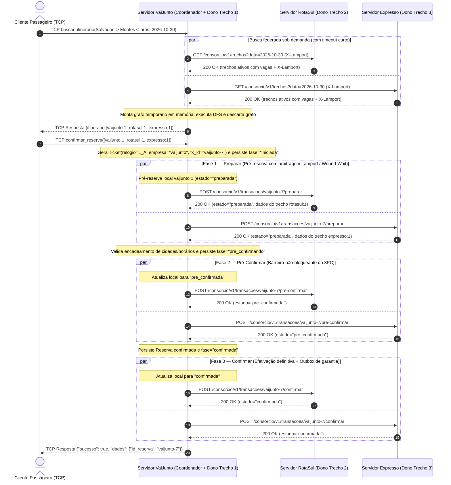

# Especificação da API REST do Consórcio — VAIJUNTO (Problema 2)

## 1. Visão Geral

No consórcio de caronas compartilhadas, cada empresa opera seu próprio servidor de forma autônoma, mantendo exclusivamente sua base de usuários, suas caronas e o controle sobre os assentos dessas caronas (persistidos localmente em `estado.json`). Não há servidor central, coordenador fixo nem banco de dados compartilhado.

Enquanto motoristas e passageiros conectam-se via socket TCP apenas ao servidor da sua própria empresa (ver [`PROTOCOLO.md`](./PROTOCOLO.md)), a **cooperação entre os servidores das empresas** ocorre por meio desta **API REST sobre HTTP/JSON**, evitando bloqueios por firewalls corporativos.

Todos os endpoints utilizam o prefixo base:

```
/consorcio/v1
```

---

## 2. Cabeçalhos Padrão e Relógio Lógico de Lamport

Como os relógios físicos das máquinas das empresas não estão sincronizados, toda requisição e toda resposta HTTP trocada entre servidores carrega dois cabeçalhos:

| Cabeçalho | Tipo | Descrição |
|---|---|---|
| `Content-Type` | `string` | Sempre `application/json` |
| `X-Empresa` | `string` | Identificador da empresa remetente (ex.: `vaijunto`, `rotasul`, `expresso`) |
| `X-Lamport` | `int64` | Valor atual do relógio lógico de Lamport do servidor remetente |

### Regras de atualização do relógio lógico
1. Antes de um evento transacional local ou de enviar uma requisição/resposta REST: `L = L + 1`.
2. Ao receber uma requisição ou resposta REST contendo `X-Lamport = L_msg`: `L = max(L, L_msg) + 1`.
3. O valor de `L` é persistido junto ao estado local da empresa para nunca regredir após reinicializações.

### Critério de precedência entre disputas concorrentes (`Ticket`)
Quando um passageiro solicita a reserva de um itinerário na sua empresa, o servidor dessa empresa atua como **coordenador dinâmico apenas daquela transação** e gera um `Ticket` imutável:

```json
{
  "relogio": 42,
  "empresa": "vaijunto",
  "tx_id": "vaijunto-7"
}
```

Um ticket `A` precede estritamente um ticket `B` (`A < B`) se:
1. `A.relogio < B.relogio`; ou
2. `A.relogio == B.relogio` e `A.empresa < B.empresa` (ordem lexicográfica); ou
3. `A.relogio == B.relogio`, `A.empresa == B.empresa` e `A.tx_id < B.tx_id`.

Na disputa pelo último assento durante a Fase 1 (`preparar`), aplica-se a política **Wound-Wait**: se o assento estiver apenas pré-reservado (`preparada`) por uma transação com ticket maior (menor precedência), a transação de maior precedência **fere (aborta)** a pré-reserva mais nova e assume o assento. Transações que já passaram pela barreira da Fase 2 (`pre_confirmada`) ou Fase 3 (`confirmada`) nunca são preemptadas.

---

## 3. Resumo dos Recursos REST

| Método | Recurso | Papel de quem recebe | Finalidade |
|---|---|---|---|
| `GET` | `/consorcio/v1/saude` | Qualquer empresa | Verificação de disponibilidade do servidor |
| `GET` | `/consorcio/v1/trechos?data=AAAA-MM-DD` | Dona das caronas | Consulta pública de trechos ativos com vagas para busca federada |
| `GET` | `/consorcio/v1/transacoes/{id}` | Coordenador ou Participante | Consulta do estado/fase de uma transação (recuperação de falhas) |
| `POST` | `/consorcio/v1/transacoes/{id}/preparar` | Participante (dona do trecho) | **Fase 1 (3PC)**: pré-reserva atômica de assentos com arbitragem de Lamport |
| `POST` | `/consorcio/v1/transacoes/{id}/pre-confirmar` | Participante | **Fase 2 (3PC)**: barreira de pré-confirmação (elimina bloqueio indefinido) |
| `POST` | `/consorcio/v1/transacoes/{id}/confirmar` | Participante | **Fase 3 (3PC)**: efetivação definitiva da reserva nos trechos da empresa |
| `POST` | `/consorcio/v1/transacoes/{id}/abortar` | Participante | Aborto explícito da transação e liberação imediata de pré-reservas |
| `POST` | `/consorcio/v1/transacoes/{id}/expirar-preparada` | Participante | Terminação cooperativa: aborta atomicamente caso ainda esteja só em `preparada` |
| `POST` | `/consorcio/v1/reservas/{id}/cancelar` | Participante | Libera assentos de uma reserva já confirmada (também aceita `DELETE /reservas/{id}`) |
| `POST` | `/consorcio/v1/reservas/{id}/cancelamento-carona` | Coordenador do passageiro | Avisa que uma carona foi cancelada pelo motorista para cancelar o itinerário em cascata |

*(Para testes automatizados, há também `GET /consorcio/v1/admin/auditoria` e, somente quando habilitado por `PERMITIR_FALHAS=1`, `POST /consorcio/v1/admin/falha`).*

---

## 4. Detalhamento dos Endpoints

### 4.1. `GET /consorcio/v1/saude`
Verifica se o servidor da empresa está ativo.

- **Respostas**:
  - `200 OK`
    ```json
    { "empresa": "rotasul", "status": "ok" }
    ```

---

### 4.2. `GET /consorcio/v1/trechos?data=AAAA-MM-DD`
Retorna os trechos de caronas ativas desta empresa com `assentos_livres > 0` e data de partida maior ou igual a `data` (permitindo conexões que virem a meia-noite). Nenhum dado privado de usuários ou passageiros é exposto.

- **Query params**:
  - `data` (opcional, formato `AAAA-MM-DD`): filtra trechos a partir da data da viagem.
- **Respostas**:
  - `200 OK`
    ```json
    {
      "empresa": "rotasul",
      "trechos": [
        {
          "empresa": "rotasul",
          "id": 1,
          "origem": "Feira de Santana",
          "destino": "Vitória da Conquista",
          "horario_saida": "2026-10-30T10:00",
          "horario_chegada": "2026-10-30T14:00",
          "preco_centavos": 5500,
          "assentos_livres": 2
        }
      ]
    }
    ```

---

### 4.3. `POST /consorcio/v1/transacoes/{id}/preparar` — Fase 1
Solicita a pré-reserva de 1 assento em cada trecho listado de responsabilidade desta empresa. Inclui a lista completa de empresas participantes para permitir **terminação cooperativa** caso o coordenador falhe antes do fim da transação. Operação idempotente por `{id}`.

- **Corpo da requisição**:
  ```json
  {
    "coordenador": "vaijunto",
    "participantes": ["expresso", "rotasul", "vaijunto"],
    "ticket": {
      "relogio": 42,
      "empresa": "vaijunto",
      "tx_id": "vaijunto-7"
    },
    "trechos": [1],
    "passageiro": "5@vaijunto",
    "lease_segundos": 3
  }
  ```
- **Códigos de retorno**:
  - `200 OK`: assento(s) pré-reservado(s) e estado persistido em disco como `preparada`.
    ```json
    {
      "id": "vaijunto-7",
      "estado": "preparada",
      "trechos": [
        {
          "empresa": "rotasul",
          "id": 1,
          "origem": "Feira de Santana",
          "destino": "Vitória da Conquista",
          "horario_saida": "2026-10-30T10:00",
          "horario_chegada": "2026-10-30T14:00",
          "preco_centavos": 5500
        }
      ]
    }
    ```
  - `400 Bad Request`: JSON inválido, lista de trechos vazia ou IDs duplicados.
  - `404 Not Found`: ID de trecho inexistente nesta empresa.
  - `409 Conflict`: sem assentos disponíveis (nem preemptáveis por *Wound-Wait*), carona cancelada ou transação `{id}` já marcada anteriormente como `abortada`.
    ```json
    {
      "id": "vaijunto-7",
      "estado": "abortada",
      "erro": "assento indisponível em um dos trechos"
    }
    ```

---

### 4.4. `POST /consorcio/v1/transacoes/{id}/pre-confirmar` — Fase 2
Enviada pelo coordenador somente após **todas** as empresas participantes responderem `200 OK` na Fase 1 e o encadeamento completo do itinerário ser validado. Ao persistir `pre_confirmada`, o participante renova o lease e blinda o assento contra preempções.

- **Corpo da requisição**: vazio.
- **Códigos de retorno**:
  - `200 OK`: transação movida para `pre_confirmada` (ou já estava `pre_confirmada`/`confirmada`).
    ```json
    { "id": "vaijunto-7", "estado": "pre_confirmada" }
    ```
  - `404 Not Found`: transação desconhecida neste servidor.
  - `409 Conflict`: a pré-reserva da Fase 1 foi abortada antes da pré-confirmação (por exemplo, preemptada por uma transação com relógio de Lamport menor, expiração de lease ou cancelamento da carona).
    ```json
    {
      "id": "vaijunto-7",
      "estado": "abortada",
      "erro": "pré-reserva não está mais ativa"
    }
    ```

---

### 4.5. `POST /consorcio/v1/transacoes/{id}/confirmar` — Fase 3
Efetiva definitivamente a pré-reserva em reserva `confirmada`. Caso algum participante esteja temporariamente inacessível na Fase 3, o coordenador registra a mensagem em sua **Outbox persistente** e a reenvia até obter confirmação.

- **Corpo da requisição**: vazio.
- **Códigos de retorno**:
  - `200 OK`:
    ```json
    { "id": "vaijunto-7", "estado": "confirmada" }
    ```
  - `404 Not Found`: transação desconhecida.
  - `409 Conflict`: transação já havia sido abortada.

---

### 4.6. `POST /consorcio/v1/transacoes/{id}/abortar`
Desfaz imediatamente a pré-reserva associada a `{id}`, devolvendo o(s) assento(s) para `assentos_livres`, e grava um registro *tombstone* (`abortada`) para impedir que um eventual `preparar` atrasado na rede volte a travar o assento. Operação idempotente.

- **Corpo da requisição**: vazio.
- **Códigos de retorno**:
  - `200 OK`:
    ```json
    { "id": "vaijunto-7", "estado": "abortada" }
    ```
  - `409 Conflict`: transação já havia sido definitivamente confirmada.

---

### 4.7. `GET /consorcio/v1/transacoes/{id}`
Consulta a situação local da transação `{id}` (tanto o campo `estado` enquanto participante quanto o campo `fase` enquanto coordenador: `iniciada`, `pre_confirmando`, `recuperando`, `confirmada` ou `abortada`). Usada por participantes cujo lease expirou (`recuperando` indica que o coordenador acabou de reiniciar após uma queda na Fase 2 e está executando a reconciliação cooperativa junto aos pares).

- **Códigos de retorno**:
  - `200 OK`:
    ```json
    {
      "id": "vaijunto-7",
      "estado": "confirmada",
      "fase": "confirmada"
    }
    ```
    *(Se a empresa não for participante da transação, `estado` retorna `"desconhecida"`).*

---

### 4.8. `POST /consorcio/v1/transacoes/{id}/expirar-preparada`
Endpoint do **Protocolo de Terminação Cooperativa**, acionado quando o lease de uma pré-reserva expira e o servidor coordenador está inacessível (caído):
- Se este participante ainda estava apenas em `preparada` (ou `desconhecida`), é matematicamente impossível que o coordenador tenha concluído a Fase 2 em todos os participantes: o servidor transiciona atomicamente para `abortada`, libera o assento e retorna `estado: "abortada"`.
- Se já estava em `pre_confirmada`, `confirmada` ou `abortada`, apenas retorna o estado atual sem alterá-lo.

Se todos os participantes responderem `pre_confirmada` (ou algum `confirmada`), todos convergem para `confirmada`; se qualquer um responder `abortada`, todos convergem para `abortada` e liberam seus assentos sem depender da volta do coordenador.

- **Códigos de retorno**:
  - `200 OK`:
    ```json
    { "id": "vaijunto-7", "estado": "pre_confirmada" }
    ```

---

### 4.9. `POST /consorcio/v1/reservas/{id}/cancelar` (ou `DELETE /consorcio/v1/reservas/{id}`)
Cancela uma reserva já confirmada (`confirmada` → `cancelada`) e devolve os assentos correspondentes nesta empresa. Idempotente e entregue via Outbox persistente caso o servidor de destino esteja fora do ar no momento do cancelamento.

- **Códigos de retorno**:
  - `200 OK`:
    ```json
    { "id": "vaijunto-7", "estado": "cancelada" }
    ```

---

### 4.10. `POST /consorcio/v1/reservas/{id}/cancelamento-carona`
Enviada pela empresa de um motorista à empresa coordenadora do passageiro quando uma carona é cancelada (além disso, a empresa do motorista também notifica diretamente as demais empresas participantes via `/reservas/{id}/cancelar` para que liberem seus assentos mesmo que o coordenador esteja temporariamente fora do ar). A empresa do passageiro marca a reserva `{id}` como `cancelada` e garante o cancelamento em cascata de todo o itinerário.

- **Corpo da requisição**:
  ```json
  { "empresa": "rotasul", "id_carona": 3 }
  ```
- **Códigos de retorno**:
  - `200 OK`:
    ```json
    { "id": "vaijunto-7", "status": "cancelada" }
    ```

---

## 5. Diagrama de Sequência — Confirmação de Itinerário Multi-Empresa

Cenário: um passageiro conectado via TCP ao servidor da empresa **VaiJunto** busca e confirma uma viagem de **Salvador a Montes Claros** composta por 3 trechos operados por **VaiJunto** (Salvador → Feira de Santana), **RotaSul** (Feira de Santana → Vitória da Conquista) e **Expresso** (Vitória da Conquista → Montes Claros).



